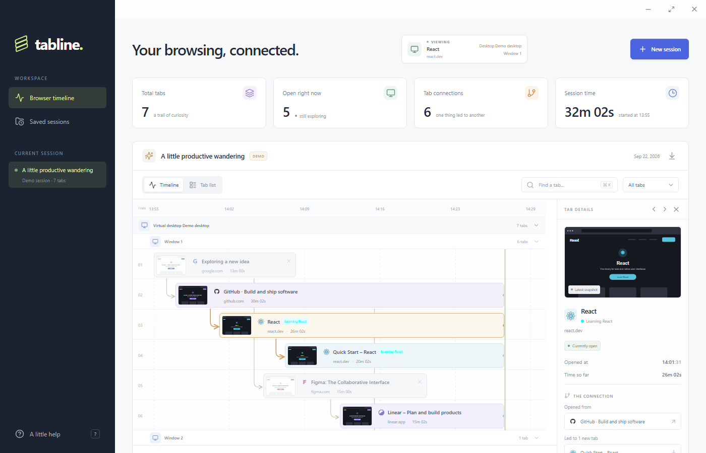
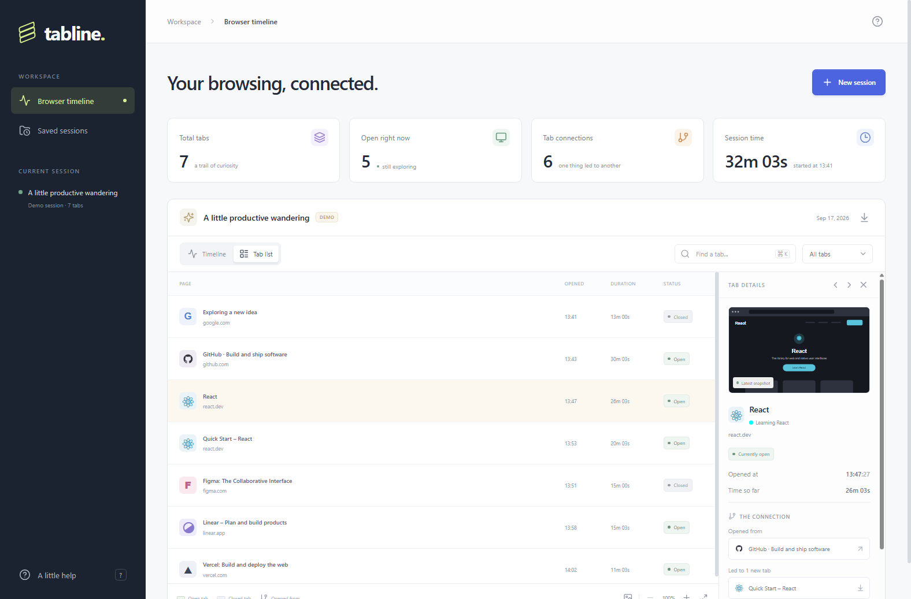

# Tabline

A local-first Electron app that turns your Helium or Chrome browsing session into a visual timeline. See when every tab opened and closed, preview its thumbnail, and follow arrows back to the tab that opened it.

See [GitHub Releases](https://github.com/Imam-f/tabline/releases) for downloads and the changelog.

The current release, **0.1.8**, adds crash recovery for saved progress, optional monitoring of multiple Tabline machines, and saved-session resume on a client machine. Helium and Chrome now remember their executable paths independently when switching browsers. Network sharing is off by default.

## Screenshots

The timeline connects each tab to the tab that opened it, with thumbnails and a details panel.



The tab list view is a compact table of pages, open time, duration, and status.



## Run

Requires **Node.js 22+** and a local installation of **Helium** or **Google Chrome** (Chromium also works with a custom executable path).

```sh
npm install
npm run dev
```

Click **New session**, choose a browser, and launch it. Common installation locations are detected automatically. For a portable installation, AppImage, or a browser installed elsewhere, expand **Browser executable** and select or paste the executable path. On macOS, use the binary inside the application bundle, for example `/Applications/Helium.app/Contents/MacOS/Helium`.

Tabline remembers a separate executable path for Helium and Chrome. Switching browsers retains each browser's path, and paths saved by earlier versions are migrated automatically.

To run the built app:

```sh
npm run build
npm start
```

To build a distributable for your operating system:

```sh
npm run dist
```

Installers are placed in `release/`. `npm run dist:dir` creates an unpacked desktop build using the locally installed Electron runtime. On Windows, open `release/win-unpacked/Tabline.exe` (keep the whole folder together). Signing credentials are needed if you want to distribute signed builds.

## What it does

- **Browser launcher** — Helium by default, with Chrome as an option and a custom executable picker. If only Chrome is installed, it is preselected.
- **Live timeline** — one lane per tab, with its opening time, lifetime, and closing time. Use the footer’s **Time** controls to shrink or zoom horizontally (25–400%) and **Lanes** controls to adjust lane height (50–200%). Reset returns both axes to 100%. Search and filter open, closed, or connected tabs.
- **Opener arrows** — connect a new tab to its parent using Chromium’s `TargetInfo.openerId`.
- **Window grouping** — resolve each tab to its Chromium browser window with `Browser.getWindowForTarget`. Both timeline and list views have independently collapsible virtual-desktop and window sections. On Windows, Tabline also maps each window to its native virtual desktop, including desktops that are not currently visible. Other platforms label virtual-desktop membership as unavailable.
- **Window move history** — browser-window membership is polled independently every second, rather than only when a tab navigates or becomes active. Each detected move is timestamped in `windowHistory` and shown in the tab details panel.
- **Tab groups** — the managed browser loads the bundled Tabline companion extension, which reports Chromium tab-group membership, group title, color, collapsed state, and changes over a localhost-only bridge. Group updates are recorded independently of page navigation.
- **Tab order and restore** — track each tab's strip position, pinned and active state, and restore the tabs that were open when a saved session ended. To restore an earlier point, open the saved session, drag the timeline's time marker (or focus it and use the left/right arrow keys), then click **Restore from here**. The companion recreates windows, ordering, opener links, pinning, and groups when available; a CDP fallback still restores validated web URLs and windows when Chrome blocks the extension. On Windows, recreated windows are moved back to their saved virtual desktop when that desktop still exists.
- **Activity history** — a separate timeline row shows active tabs across time. Hover over it to read which tab was active in each window at a specific second, or click to move the timeline marker there. The companion reports changes as they happen; when it is unavailable, Tabline samples tab visibility and focus through DevTools every second. Activity history is included in saved sessions and JSON exports.
- **Thumbnails** — real JPEG snapshots after page changes and approximately every 60 seconds. Select a tab to view a larger preview or refresh it manually.
- **Tab details** — page history, parent and child tabs, duration, and buttons to focus or close an open browser tab.
- **Tab freezer** — the Tabline companion extension can turn an individual tab into a persistent local short URL backed by its latest screenshot. Tabs inactive for five minutes get a preserved screenshot; after ten minutes they move to the snapshot page. The snapshot page has a floating return button, and the app's tab details panel also provides **Freeze tab** and **Return to original page** controls for live tabs. The extension can whitelist the current tab; its **Freeze all tabs** action freezes other tabs across all browser windows and virtual desktops, leaving the current tab and whitelisted pages untouched. Extension UI pages are excluded from the timeline.
- **Concurrent sessions** — track multiple browser sessions at once and switch between them from the session tabs or sidebar. Every session has an isolated browser data directory cloned from the previous session; restoring a saved session automatically duplicates its profile and timeline into a new live session.
- **Network instances** — monitor several Tabline machines simultaneously, with automatically updating remote timelines and reconnection. Client mode waits for another instance to request a saved-session restore on the client machine.
- **Saved sessions** — automatically persist timelines, navigation history, and thumbnails locally. Click a saved session to select it, double-click to open it, or drag it to reorder. Organize sessions into folders, rename or delete them, and export an opened session as portable JSON. In **Saved sessions**, click **Import session** to load a JSON export, or **Import from remote** to choose a connected machine. Imports create independent local copies with new IDs, preserving history, thumbnails, groups, and tab connections. Open an imported session to view its timeline or restore its tabs locally. Deleting a session also deletes its browser data directory.
- **Crash recovery** — save changes to disk before displaying updates, with atomic replacement and a backup of the previous save. After an interruption, open **Saved sessions** to recover the timeline and restore its open tabs. Folder organization and freezer data also recover from complete pending saves or backups.
- **Demo mode** — explore an example timeline without launching a browser. The standalone web preview (`npm run dev:web`) uses the demo; browser launching requires Electron.

## Long-term goals

- **Global search** — search across all saved sessions, pages, navigation history, and archived content.
- **Fuzzy search** — find relevant tabs and pages even when search terms are incomplete or slightly misspelled.
- **Vector search** — use semantic similarity to discover related pages and browsing history by meaning, not only exact words.
- **OCR** — extract searchable text from screenshots and captured page images.
- **Automatic tagging** — classify and organize tabs and sessions using generated tags.
- **Offline archive** — preserve a durable, fully local archive that remains searchable without network access.
- **Screenshot graph editor** — edit and arrange relationships between captured screenshots as a visual graph.
- **Screenshot annotator** — add notes, highlights, and other annotations directly to captured screenshots.

## Connect machines

Open **Network instances** in the desktop app on each machine. Networking is off by default.

1. Choose **Host** to share local timelines and monitor other machines, or **Client** to also accept requests to resume saved sessions on this machine. Apply the settings. Client mode waits without launching a browser; local browser sessions can still run and be tracked normally.
2. On the monitoring machine, click **Add instance**, enter the other machine’s displayed address and its connection token, and apply the settings. Add several machines to monitor them together. Add the connection on both sides if both machines should monitor each other.
3. Connected machines show their open timelines and saved sessions. **View timeline** opens a remote timeline that updates every two seconds. **Resume on client** reopens the selected saved session on that client using its own saved data and browser profile. It creates a new live session and preserves the saved source. The client chooses an installed browser using the existing restore fallback.
4. Click **Import to this device** beside an open timeline or saved session to save a local copy, including its history and thumbnails. This works with both host and client machines running a version that supports imports. An open timeline is imported as a snapshot at the time of transfer. Imports appear selected under **Saved sessions → Unfiled** and can be viewed or restored even after the source machine disconnects. Browser profiles, cookies, and logins are not included.

Use a trusted LAN or VPN and allow the selected listen port (default **45831**) through the machine’s firewall. The listener binds to all IPv4 interfaces when enabled. HTTP traffic is not encrypted and includes the token, URLs, history, and screenshots. Anyone with an instance’s token can read its shared sessions and, in client mode, request a restore. Tabline rejects unauthenticated requests and browser-origin requests; remote restore requests accept only saved session IDs and optional timeline times, never executable paths. Browser profiles, cookies, and login files are not transferred. **Off** stops listening and monitoring; settings persist for the next launch. Offline machines reconnect automatically and show their last received timeline as offline.

Each machine saves its own sessions independently; network connections provide monitoring, remote resume, and importing copies to this device. To run independent instances on one machine, set **TABLINE_DATA_DIR** to a different absolute directory for each process and choose a different network port in each instance. For example, in PowerShell:

```powershell
$env:TABLINE_DATA_DIR = 'C:\Tabline\client-one'
npm start
```

Run another process from a separate terminal with another directory. Instances using the same data directory retain the single-instance lock.

## How it works

The Electron main process starts the selected Chromium-based browser with:

```text
--remote-debugging-port=<available local port>
--remote-debugging-address=127.0.0.1
--user-data-dir=<Tabline app data>/browser-data/profiles/<session UUID>
```

It discovers the browser’s DevTools WebSocket through the local `/json/version` endpoint and subscribes to `Target` discovery events. A nonzero debugging port avoids Chrome's automation mode, which displays the “controlled by automated test software” banner and can block Google sign-in. Screenshots use short-lived flattened target sessions and `Page.captureScreenshot`. The companion extension is loaded only into Tabline’s dedicated browser profile because Chromium’s DevTools Protocol has no tab-group API.

Google Chrome builds can reject the `--load-extension` flag for security reasons. When that happens, window/timeline tracking still works, but Chrome will not provide native tab-group metadata. Use Helium or a Chromium build that permits unpacked extensions for automatic group colors, or manually load `electron/tabline-extension/` into the managed profile from `chrome://extensions` with Developer mode enabled. If the browser does not expose a stable target ID, Tabline ignores ambiguous duplicate-URL matches rather than assigning a group to the wrong tab. Fallback colors are deterministic by group ID, not the browser’s native color.

Tabline uses a dedicated, persistent browser profile per session. This is required by current Chrome remote-debugging restrictions and keeps tracked browsers separate from your normal profile. A new session copies the previous session's browser data, so bookmarks, logins, and browser state carry forward while each live browser remains isolated. Multiple tracked sessions can run at once. Ending a session closes only its managed browser and saves its timeline.

The renderer is sandboxed with context isolation, no Node integration, a restrictive Content Security Policy, and a small preload IPC bridge. Debugging binds to localhost with an automatically assigned port. The app uses local fonts. Timeline data stays local unless you enable network sharing with other instances.

### Details worth knowing

- Arrows are shown when the browser reports an opener. Tabs created through the address bar, bookmarks, or an operation that does not retain an opener can appear as independent roots. A companion extension is not used to infer missing relationships.
- Existing/restored tabs at connection time are timestamped when Tabline first observes them. The DevTools Protocol does not provide a historical tab creation timestamp.
- A thumbnail is the latest captured viewport, not a recording of the page. Protected/internal pages or tabs closed immediately may have no screenshot. Closed tabs keep the last successful snapshot.
- A tab’s navigation history is recorded during the session. The detail panel shows its four latest pages; the JSON export contains the full history.
- Long sessions with many thumbnails increase local storage usage. To remove a saved session, click its trash icon in the saved-session list and confirm **Delete session**.

## Local data

Data lives inside Electron’s platform-specific `userData` directory:

| Platform | Typical location |
| --- | --- |
| Windows | `%APPDATA%/tabline/browser-data/` |
| macOS | `~/Library/Application Support/tabline/browser-data/` |
| Linux | `~/.config/tabline/browser-data/` |

The `sessions/` folder contains JSON sessions (including base64 JPEG thumbnails). `freezer.json` contains persistent local short-URL mappings, whitelist entries, and frozen screenshots. The `profiles/` folder contains one UUID-named browser data directory per session. Deleting a session removes both its JSON and profile directory. URLs and visible page content can be present in session exports and freezer data.

`network.json` stores this instance’s identity, mode, port, and connection tokens for configured machines. Remote timelines are held in memory and do not overwrite local saved sessions.

Session changes are saved and flushed to disk before the app displays the update, including during continuous browsing. Writes replace JSON files atomically and retain the previous version in a `.bak` file. After an app or browser crash, reopen Tabline and go to **Saved sessions** to view the recovered timeline or click **Restore** to reopen its tabs. Loading automatically recovers complete pending `.tmp` files or backups if a save was interrupted or the main file is damaged. Recovery preserves navigation and activity history, thumbnails, groups, and the tabs that were open at the last save. Folder organization and freezer data use the same protected storage. Pages themselves, including unsaved text inside websites, remain subject to the browser's own recovery behavior. Disk failures can still prevent saving; Tabline reports save errors in the app.

## Development & checks

```sh
npm test             # tracking, crash recovery, imports, URL validation, network instances
npm run build        # TypeScript check and production renderer build
npm run test:browser # real-browser integration check using local fixture pages
npm run test:desktop # production Electron UI and preload end-to-end check
```

The browser integration check detects an installed browser, launches it with a temporary profile, opens a child tab, captures a JPEG, navigates, focuses and closes tabs, then verifies the saved session. Set `TABLINE_BROWSER_PATH` to test a specific executable and `TABLINE_TEST_TEMP` to choose a temporary-directory parent.

### Project structure

```text
electron/
  main.cjs                Electron window, IPC, and lifecycle
  preload.cjs             Sandboxed renderer bridge
  session-manager.cjs     Concurrent browser-session routing and active-session state
  session-import.cjs      JSON import validation and portable timeline normalization
  network.cjs             Authenticated instance monitoring and client restore listener
  browser.cjs             Browser launch, tracking, capture, persistence, restore, freezer
  storage.cjs             Flushed atomic JSON writes, backups, and recovery
  cdp.cjs                 DevTools WebSocket client
  virtual-desktop.cjs     Windows virtual-desktop helper process bridge
  virtual-desktop.ps1     Native Windows desktop lookup and window placement
  tabline-extension/
    manifest.json         Companion extension configuration
    background.js         Tab metadata reporting and inactivity freezing
    popup.html            Companion popup markup
    popup.js              Freeze, return, whitelist, and close controls
    popup.css             Companion popup styles
src/
  main.tsx                React renderer entry point
  App.tsx                 Timeline, tab details, launcher, saved sessions
  NetworkPanel.tsx        Network settings, connected machines, remote resume controls
  types.ts                Session, tab, and preload API types
  demo.ts                 Clearly labeled interactive demo data
  styles.css              Responsive desktop interface
scripts/
  start-electron.cjs      Desktop launcher for development and built app
  browser-smoke.cjs       Real-browser integration check
  desktop-smoke.cjs       Production Electron UI and preload end-to-end check
  desktop-harness.cjs     Isolated user-data setup for the desktop check
tests/
  browser.test.cjs        Automated browser-controller and CDP tests
  network.test.cjs        Multi-instance monitoring, authentication, reconnect, remote restore
  session-import.test.cjs Local import, validation, independent copies, restore selection
  storage.test.cjs        Forced termination, interrupted saves, backups, and recovery
docs/                    README screenshots
public/                  Static renderer assets
index.html               Renderer HTML entry point
vite.config.ts           Renderer development and build configuration
tsconfig.json            TypeScript configuration
package.json             Dependencies, scripts, and desktop packaging configuration
```
